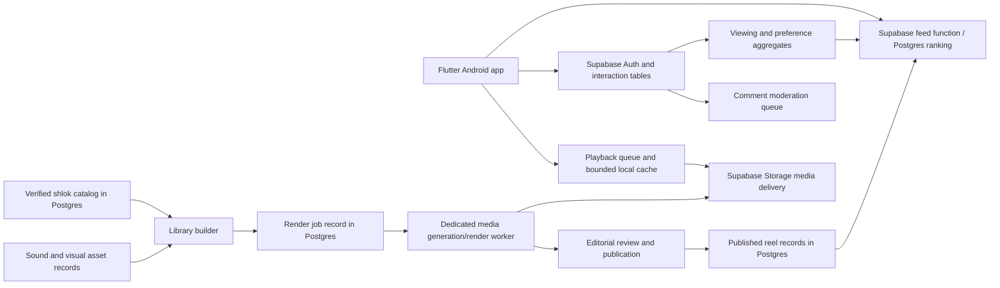

# Product plan

## Product promise

A calm, respectful way to encounter Bhagavad Gita shloks in a vertical video feed. Every reel presents the source verse, an understandable meaning, a soothing audio bed, and visuals inspired by the text. The app adapts the order of reels to a viewer's interests without changing or inventing the scripture.

## Audience and release scope

Android first on Google Play, built in Flutter with Supabase as the backend. A viewer can browse without an account; Supabase Auth sign-in is required to post a public comment and may be required to sync likes across devices. The exact sign-in method is a product decision. A small, curated launch catalog is preferable to a large unreviewed catalog.

### V1 must include

- Full-screen vertical feed with swipe, preloading, pause/resume, mute, replay, and reliable pagination.
- Original Sanskrit shlok and Hindi meaning in the Sanskrit viewing mode. Every reel shows chapter and verse reference and a way to read the full text.
- Like/unlike, public comment list and posting, report content/comment, block user, and moderation workflow.
- Basic personalization, explicit topic or chapter preferences, and controls to reset recommendations or hide a reel/topic.
- Curated AI-assisted animated visuals, reviewed audio, captions, and source metadata.
- A library builder that creates, records, reviews, and publishes new shlok + sound + visual combinations into the shared feed catalog.
- Analytics for eligible watch time, completion, rewatch, likes, comments, skips, hides, playback failures, and feed quality.
- Privacy notice, account deletion route for accounts, data controls, store listing, and release checks.

### Later, if validated

Saved collections, narration, offline packs, creator uploads, live generation, advanced semantic ranking, and iOS. User uploads should not be mixed into v1 because they enlarge moderation and rights scope.

## Journeys

1. **First visit:** choose language display and optional interests (chapter, theme such as duty or equanimity); preview a reel; enter feed without mandatory sign-in.
2. **Watching:** video starts muted or at a remembered sound preference; Sanskrit text and Hindi meaning remain legible; swipe to next; tap to pause; open full verse or reference.
3. **Engaging:** like instantly with optimistic feedback; comment opens a sheet; sign-in prompt appears only when posting; report and block are reachable from the comment menu.
4. **Changing the feed:** use “Show less like this,” manage interests, or reset personalization in Settings.
5. **Poor connection:** play a prefetched reel if available, show a clear retry state if not; do not trap the user in a spinner.

## System boundary

The Flutter client handles playback, UI, and a bounded local cache. Its v1 playback queue keeps the current reel ready, preloads up to two upcoming reels, and briefly retains the previous reel for a back swipe. It requests more ranked reel metadata before the queue runs low, and adjusts media preloading to network and device conditions. Supabase Postgres owns shloks, sound and visual asset metadata, reel combinations, publishing state, likes, comments, watch events, and viewer preferences. Supabase Auth handles commenter identity. Row Level Security (RLS) restricts viewer access; privileged publishing and moderation operations stay server-side. A Supabase Edge Function or Postgres function supplies ranked, cursor-based feed pages. Supabase Storage holds prepared media, with delivery and cost tested against expected video traffic. The library builder records each compatible shlok, sound, and visual combination in Postgres; a dedicated worker handles long-running AI generation and video rendering, then writes the rendered outputs to Supabase. After review and publication, the reel ID enters the shared candidate pool for all viewers. Ranking stays server-side so the app can evolve without a client update.

The rendering worker is a separate compute component of the Supabase-backed system. Its hosting is an implementation decision; Supabase remains the source of truth for jobs, assets, and publication. Do not place long-running video generation on a feed request or assume a short API function can render video reliably.

## Delivery sequence and exit gates

| Phase | Outcome | Gate |
|---|---|---|
| 0. Editorial prototype | 10–20 reviewed sample reels across both styles | Scripture reviewer approves text, meaning, visual interpretation, and audio rights. |
| 1. UX validation | Clickable screen prototype and short user sessions | Viewers can read the verse, understand actions, and distinguish the two styles. |
| 2. Private Android build | Playback, account, likes, comments, moderation, feed API | Smooth scroll and recoverable errors on representative low and mid-range Android devices. |
| 3. Closed test | Curated catalog, ranking v1, analytics, support workflow | No dead-end feed in long sessions; moderation and data controls work. |
| 4. Play release | Store assets, policy review, staged rollout | Current target API, Data safety, content policies, and account requirements checked in Play Console. |

## Success measures

- Feed reliability: time to first playable reel, playback starts, stall rate, next-reel availability, and crash-free sessions.
- Content usefulness: full-verse opens, saves if added, positive feedback, and short qualitative interviews. Avoid optimizing only for screen time.
- Feed health: repeat frequency, topic diversity, skip rate, and “show less” rate.
- Community safety: comment reports, moderation response time, repeat offenders, and false-positive appeals.

No target percentages are invented yet; establish baselines in the closed test.

## Decisions to confirm

1. Aside from the Sanskrit + Hindi mode, which languages should appear at launch? Is Hindi the default meaning for every user?
2. Choose the primary reel style after reviewing the two mockups. A mixed feed is possible, but style becomes a ranking dimension.
3. Who will approve translations, verse selection, and visual depictions? Which Hindi translation may be used or licensed?
4. Should the soundtrack be instrumental, chant-based, verse recitation, or a selectable mix? Who owns the recordings?
5. Which Supabase Auth sign-in method, community rules, and moderation staffing are available for public comments?
6. What launch budget and timeline should size the catalog, video resolution, and generation workflow?

## Release research notes

The [official Android target API guidance](https://developer.android.com/google/play/requirements/target-sdk) changes over time; check it again immediately before release. Also complete Google Play's current Data safety and content policy forms in Play Console based on the actual shipped app. This plan intentionally does not freeze a future target API number.

Supabase service choices should be validated against current [Flutter integration](https://supabase.com/docs/guides/getting-started/quickstarts/flutter), [Storage](https://supabase.com/docs/guides/storage), [Edge Functions](https://supabase.com/docs/guides/functions), and [RLS guidance](https://supabase.com/docs/guides/database/postgres/row-level-security) during implementation.
