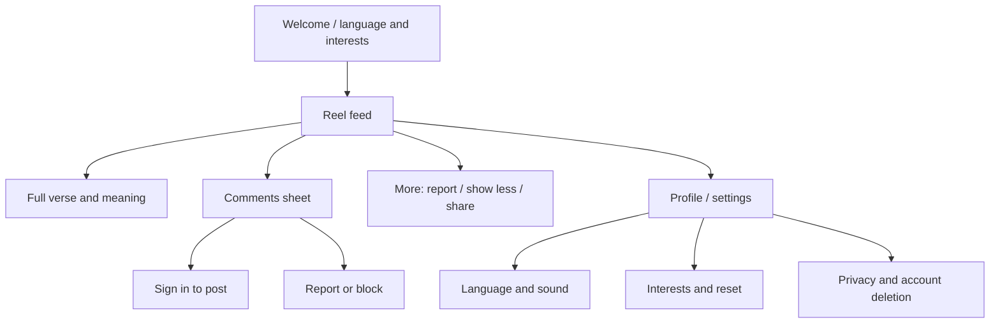

# UI design plan

## Design direction

A quiet, cinematic canvas based on the supplied visual reference: near-black backgrounds, warm amber glow, luminous yellow primary actions, subtle stars and circular linework, restrained motion, and high-contrast text. Use original Geeta app branding and avoid astrology-specific symbols. The same dark theme applies to reels, comments, onboarding, and settings. The [Flutter design system](DESIGN_SYSTEM.md) defines exact tokens and component behavior. Keep UI chrome light so the verse remains central. Avoid visual clutter, autoplay sound surprises, and gamified streak pressure.

The [two sample feed screens](mockups.svg) illustrate styles using Bhagavad Gita 2.47. The verse and Hindi meaning are draft display copy and must pass editorial review before production.

### Style A — devotional

Slow, atmospheric scene, subtle chant or instrumental bed, the complete shlok and a concise Hindi meaning. Best for reflection and a calmer feed rhythm. A full-screen text panel remains one tap away.

### Style B — explanatory

The same canonical verse with an animated scene, a brief contextual Hindi takeaway, and a “Read full meaning” affordance. Better for learning, but interpretation requires tighter editorial review. The complete source verse remains available immediately.

The feed may use both styles, but present them as distinct content treatments. Decide after user testing which is the default and whether users can filter by style.

## Screen map

## Feed layout and interaction

- Video fills the screen under safe areas. A dark gradient behind captions ensures text contrast across any visual.
- Top: app name or small chapter theme; optional search can wait. The chapter and verse reference is always visible.
- Center/lower third: Sanskrit verse, then Hindi meaning in Sanskrit mode. On short screens, a compact verse preview opens the complete, scrollable text panel; never truncate silently.
- Right rail: like, comments, share, and more. Show labels or accessible names and generous touch targets.
- Bottom: sound control, pause/play affordance, source/translation credit, and progress indicator. Swiping changes reel; tapping media pauses/resumes.
- Comments open a dark bottom sheet that preserves the current reel position and sound state. Composer uses sign-in when needed. Comment menu exposes report and block.
- Loading: poster image followed by video, then the next reel. On playback failure, show retry and skip; preserve the current feed position.

## Additional screen specifications

| Screen | Essential content | States to design |
|---|---|---|
| Welcome | language, optional interests, sound default | first run, skip, permission explanation |
| Full verse | Sanskrit, Hindi meaning, chapter/verse, source credit | long text, loading, accessibility text scale |
| Comments | list, composer, report/block, moderation notice | empty, locked, slow network, removed comment |
| Profile/settings | language, sound, interests, reset, privacy, account deletion | anonymous vs signed-in |
| Feed error | cached poster/reel, retry, skip | offline, asset unavailable, API unavailable |

## Accessibility and localization

Use readable Devanagari fonts with complete glyph coverage and adequate line height. Test large system text, TalkBack order, captions with audio muted, contrast on bright imagery, and reduced-motion preference. Do not put scripture text only inside generated images. Store canonical text and translations separately, with versioning and credits. RTL layouts are not needed for the initial Sanskrit/Hindi mode, but keep content and UI localization separate.

## Prototype review checklist

- Can a viewer read the full verse without pausing at a precise moment?
- Is the meaning clearly distinguished from the original shlok?
- Is sound state obvious and under the viewer's control?
- Can a viewer recover from a stalled reel and keep scrolling?
- Can a commenter report, block, edit/delete their own comment, and understand moderation state?
- Do the two styles feel respectful, useful, and visually distinct?
